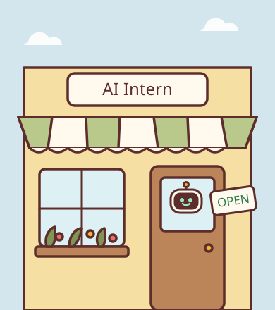
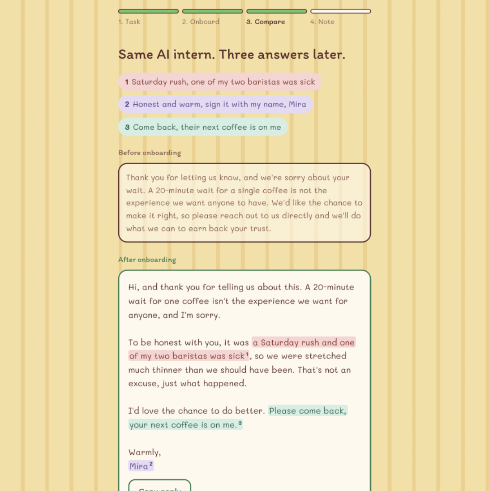
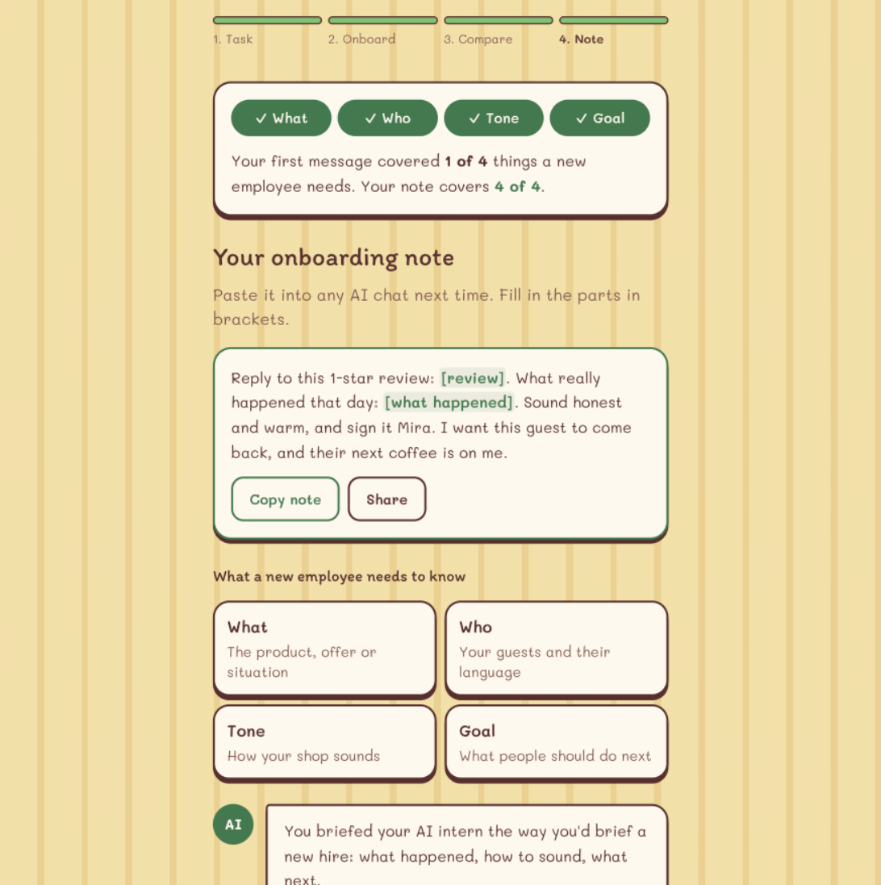

<div align="center">



# AI Intern ☕

**Onboard your AI intern like a new employee, and it starts sounding like your shop.**

[**▶ Try the live app**](https://pomelo-weld.vercel.app) · [**🎬 Watch the 2-minute demo**](https://drive.google.com/file/d/1-n08wdy2zb7ryZxRhmLvyt8flApMXRQ1/view) · [Project page](https://sigeek.github.io/pomelo/) · [How Claude is used](#-how-claude-is-used) · [Evidence](#-evidence)

<sub>Built in one day at the <a href="https://github.com/Claude-Community-Berlin/claude-impact-lab-berlin-2026-10-17">Claude Impact Lab Berlin</a>, 17 Oct 2026, by team Pomelo.</sub>

</div>

---

## 🧁 Who it's for

Owners of small cafés, bakeries and shops in Berlin (1 to 10 staff) who answer reviews and post online themselves, usually late at night.

## 😩 The problem

They try AI once, type one vague line, get a stock answer that sounds like a chain, and decide AI isn't for them. In Germany only **19% of firms with fewer than 5 employees** used AI between 2022 and 2024, and lack of skills and lack of time are the top barriers ([KfW Research, Feb 2026](https://www.kfw.de/PDF/Download-Center/Konzernthemen/Research/PDF-Dokumente-Fokus-Volkswirtschaft/Fokus-2026/Fokus-Nr.-533-Februar-2026-KI-Mittelstand.pdf)).

**Every owner already has the skill that fixes this: onboarding a new employee.**

## ✨ What it does

Meet Mira (fictional). She owns Kiez Café and it's Sunday night. A 1-star review is waiting: *"Waited 20 minutes for one coffee. Never again."*

| | Step | What happens |
|---|---|---|
| 🏪 | **Open your café** | No login. Start on the owner's real task. |
| 📝 | **Give the AI intern a task** | "Reply to a review", "Instagram post", "Job ad", or anything typed in. |
| ⭐ | **Rate the first try** | It's a stock apology. Mira gives it 2 stars: *too generic*. |
| 💬 | **Onboard** | Three questions a new barista would need answered: what happened, how you sound, what the guest should do. Tap a suggestion or type your own. |
| 🎨 | **Compare** | The new reply sounds like Mira. **Each answer and the sentences it produced share a colour and a number**, so she sees exactly what her words changed. She ticks *"I've checked it"* before she can copy. |
| 📒 | **Keep the note** | A reusable brief for any AI chat, and a meter: her first message covered **1 of 4** things a new employee needs; her note covers **4 of 4**. |

| The compare screen | The note |
|---|---|
|  |  |

<sub>Screenshots from the live app with the real Claude API, not demo data.</sub>

🎬 **[Watch the 2-minute demo video](https://drive.google.com/file/d/1-n08wdy2zb7ryZxRhmLvyt8flApMXRQ1/view)**

Phone first, nothing is stored, and nothing is ever posted for you.

## 🤖 How Claude is used

Claude plays three roles, each with its own system prompt in [`prompts/`](prompts/):

| Role | Reads | Produces |
|---|---|---|
| **AI intern** | The owner's message, later their 3 answers | The reply or post. It never invents facts it wasn't given. With answers, it wraps every phrase in the answer it came from (`<a1>…</a1>`), which drives the colour linking. |
| **Coach** | The owner's message | Which of the four essentials (what, who, tone, goal) are already there, 3 onboarding questions for the rest, and tappable example answers. |
| **Lesson** | Message, answers, both outputs | A reusable note with `[blanks]`, what changed and why, and a one-line takeaway. |

- **Model:** `claude-sonnet-5-5` through the Anthropic API (`CLAUDE_MODEL` to change it).
- **Structured output:** coach and lesson each get one strict JSON-schema tool, and the server validates every answer (exactly 3 questions, numbers 1 to 3, 2 to 3 suggestions). Anything that fails falls back to demo data.
- **Never a blank screen:** if a live call fails, the app shows clearly labelled demo data instead of an error. Malformed tags fall back to plain text.
- **The owner stays in control:** a warning appears if the message contains an email address or phone number, the owner must tick *"I've checked it"* before copying, and nothing is posted automatically.
- **Cost guard for the public link:** a per-instance cap (`MAX_REQUESTS_PER_HOUR`, default 200) and a 4,000-character limit, both with a friendly message. A full session costs about 1 to 2 cents.

## 📊 Evidence

We didn't get to test with a real café owner on the day, so we won't claim a reaction we don't have. What we can show:

**A blind test.** 10 Instagram briefs ran through the live app. A separate Claude judge (Opus 5.5) scored the posts without knowing which came first.

| | Before onboarding | After onboarding |
|---|:---:|:---:|
| Specific (1 to 5) | 1.0 | **4.5** |
| Sounds like the shop (1 to 5) | 1.8 | **4.6** |
| Clear next step (1 to 5) | 2.5 | **4.5** |
| Judge preferred | 0 of 10 | **10 of 10** |

Method and limits: [`eval/RESULTS.md`](eval/RESULTS.md). Run it yourself with `npm run eval`.

**A visible learning signal.** The meter goes from 1 of 4 to 4 of 4, and the owner leaves with a note they can reuse in any AI chat.

**Next step:** test it with owners in the AI workshops that chambers and craft associations already run (IHK, Handwerkskammer, Mittelstand-Digital Zentren), and track whether they reuse the note.

## 🚀 Run it locally

```bash
cp .env.example .env    # paste your ANTHROPIC_API_KEY into .env
npm install
npm run dev             # open http://localhost:3000
```

No key? `npm run mock` runs the whole flow on demo data for all three presets.

## 🛣️ What's next

Our designer's [Paper](https://paper.design) prototype shows where this goes: a café counter with daily orders, an AI Business Passport the owner exports to Claude or ChatGPT, the AI intern reading the shop's website first, and a German UI.

## 👋 Team Pomelo

| | Name | Role |
|---|---|---|
| 🛠️ | [Shinbeom](https://www.linkedin.com/in/shinbeom-pyeon/) | Builder |
| 🛠️ | [Silvia](https://www.linkedin.com/in/silvia-giammarinaro) | Builder |
| 🎨 | [Dima Durah](https://www.linkedin.com/in/dima-durah) | Product design |
| 🎓 | [Yuan](https://www.linkedin.com/in/xiaoyuan-zhang-171038108) | Domain expert |
| 🚀 | [David Koenig](https://www.linkedin.com/in/david-brandon-koenig-32635439a/) | Founder |

## 🙏 Credits

- [Next.js](https://nextjs.org) and [Tailwind CSS](https://tailwindcss.com) (MIT)
- [Anthropic TypeScript SDK](https://github.com/anthropics/anthropic-sdk-typescript) (MIT)
- [Itim](https://fonts.google.com/specimen/Itim) and [Mali](https://fonts.google.com/specimen/Mali) (SIL Open Font License)
- Visual style and storefront illustration from our own Paper prototype
- Hosted on [Vercel](https://vercel.com)
- "AI as an intern" idea popularised by Ethan Mollick
